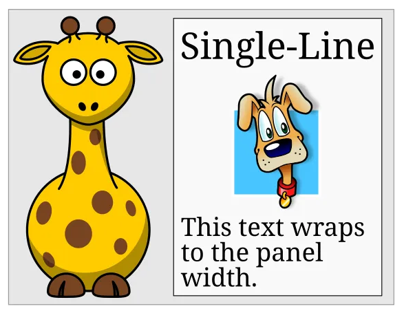
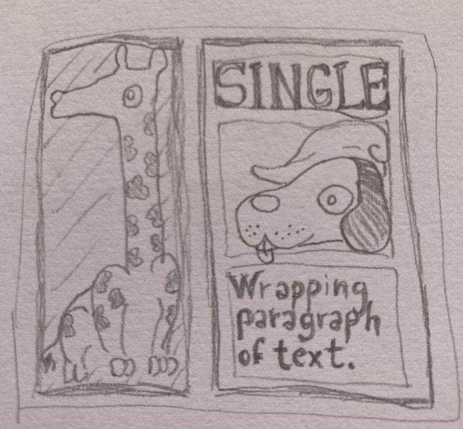
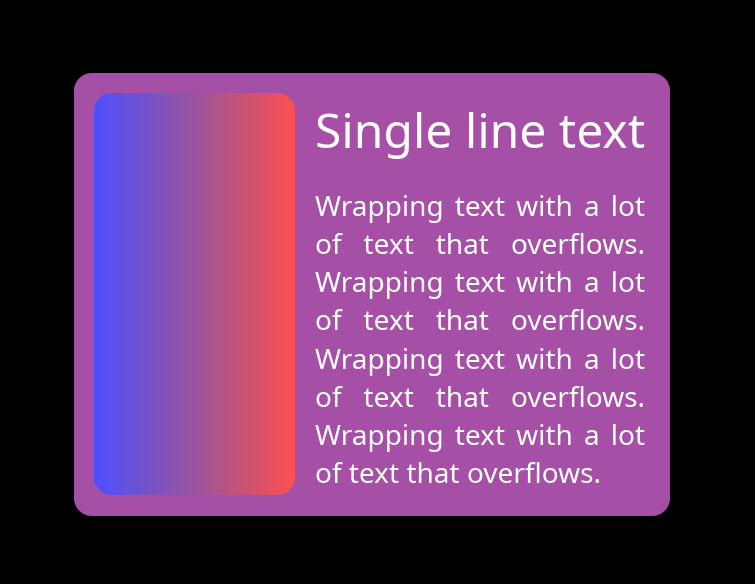

+++
title = "A New GUI Layout Algorithm"
date = 2026-11-03
+++

Earlier this year I wrote a blog post about an experimental layout algorithm that I was trying for Keru, my GUI library. After some more experimentation, I found a way to rewrite the algorithm that keeps all of the good properties of the previous one, but is also much faster. According to [a benchmark](https://github.com/kekelp/arewelayoutyet) that I forked from [marc2332](https://github.com/marc2332/arewelayoutyet), it's now one of the fastest layout libraries out there. This time, I made a separate `keru_layout` crate for it, and I'm rewriting the blog post to keep the background explanation but describe the new faster algorithm, include a link to the benchmark data, and talk a bit about incremental relayout.

Traditionally, GUI layout was more of an art than a science: a layout library would offer some layout primitives that the user can compose, but when it comes to solving them into real rectangle coordinates, it usually makes no real promises. It's sort of common to do a fairly half-hearted attempt, give out an inconsistent answer, and declare that particular layout unsupported.

The enlightening example is this innocent-looking giraffe layout, taken from [this blog post by Edaqa Mortoray](https://mortoray.com/why_ui_layout_calculations_are_slow/):

<figure>
    
    <figcaption>You can ignore the dog, as it doesn't participate in the layout in any interesting way.</figcaption>
</figure>

In this layout, the multi-line paragraph fits to the width of the single-line label. The giraffe fills the height of the whole right section, and its width is half of its height, to preserve the aspect ratio of the bitmap image. As it turns out, most algorithms struggle with this.

For example, the `clay` algorithm can't solve this case. If you write it in [the obvious way](@/css_giraffe.md), CSS won't solve it properly either: the giraffe stays at zero width. With enough nudging, like setting `writing-mode: vertical-lr` on the giraffe and on the h-stack, you can [convince the CSS engine that this really matters for correctness](@/css_giraffe_working.md), and it will solve it properly (thanks Nico Burns for figuring this out). But `vertical-*` is the writing mode used for vertically-aligned text runs, like in Mongolian and traditional Chinese and Japanese: it's fair to say that most users wouldn't think of resorting to this to get an `aspect-ratio` to work properly.

To be clear, I don't think this is necessarily a huge problem: especially in the case of `clay` there's nothing wrong with sticking to a simpler and faster algorithm if it works for the intended application. There's plenty of GUI programs that work great without any advanced layouts of this kind and don't run into any of these issues.

However, it's not uncommon to hear people complaining about the unfriendliness of layout systems. If it was possible to find a more general solution that worked in a more consistent and predictable way without surprises, it might go a long way towards making the system feel more reliable and user-friendly.

My interpretation of these limitations is that they are due to the fact that most layout algorithms are implemented through a series of top-down or bottom-up tree traversals, and the dependencies in the giraffe example just don't line up with them. As the original giraffe blog post notes, solving an arbitrary dependency graph by doing multiple passes until everything is solved leads to exponential complexity, so the algorithms cut some corners. Unless we can convince CSS that it might break Mongolian text if it doesn't honor our layout exactly, sometimes it will just give up.

To understand what was going on, I tried drawing the giraffe on paper and asking myself what an ideal layout engine would do to solve this layout properly.

<figure>
    
    <figcaption>Again, you can ignore the dog.</figcaption>
</figure>

It turns out that in this case there's a pretty straightforward dependency chain:

- The single-line text determines the width of the v-stack on the right.
- The wrapping text fills the width of the v-stack, and determines its height by wrapping.
- The heights of the single-line text and the wrapping text sum up to determine the height of the h-stack.
- The giraffe fills the height of the h-stack, and determines its width by aspect-ratio.
- The widths of the giraffe and the v-stack sum up to determine the width of the outer panel.

## The Algorithm

To avoid the problem and to avoid the performance hit, the solution is to use an algorithm that traverses this dependency chain in that order, directly.

Conceptually, these layout dependencies form a graph. Simplifying a bit for now, every element in the graph is a `(NodeID, Axis)` pair, and each dependency is an edge in the graph: `{ dependent: (NodeID, Axis), depends_on: (NodeID, Axis) }`.

The previous version of the algorithm would go through all nodes of the tree and note down all the edges. For example, a node with `size_x = Fill` would push `{ dependent: (node_id, X), depends_on: (parent_id, X) }`,. If it had `size_x = FitContent`, it would push `{ dependent: (node_id, X), depends_on: (child_id, X) }` for each of its children.
Then, it would solve the graph using what I later found out was called Kahn's algorithm: push all nodes with no dependencies in a queue and solve them. For each solved node, see if any of the nodes depending on it dropped down to zero unsolved dependencies: if yes, push it to the queue as well, and continue solving the queued nodes until everything is solved.

While this wasn't the fastest way to do it, it worked, and having an explicit list of edges was quite useful for debugging: for example, the edges could be displayed as a real graph using standard tools.

<figure>
    
    <figcaption>The giraffe layout solved with the original algorithm. The giraffe is replaced by a gradient, as I didn't have an aesthetically consistent giraffe picture. However, you can see that the gradient has the correct aspect ratio.</figcaption>
</figure>

## The Fast Algorithm

It turns out that the fast version of this algorithm is even simpler than the explicit one.

1) Go through all nodes in any order and call a `solve(node)` function to solve it.
2) In `solve(node)`, first call `solve_all_dependencies(node)`.
3) In `solve_all_dependencies(node)`, recursively call `solve(dependency)` for every unsolved `dependency` that `node` will have to read to compute its own layout.
4) After the recursion, then calculate `node`'s own layout.

That's it! This is enough to ensure that the algorithm will solve all the nodes in the correct dependency order. But in this way, there's no need for a separate pass that writes down the edges explicitly.

Of course there's nothing new about this approach either, you can find it described on the [Wikipedia page on topological sorting in the "depth-first search" section,](https://en.wikipedia.org/wiki/Topological_sorting#Depth-first_search) right below the section on Kahn's algorithm. But sometimes just knowing about these things is not enough, you have to live it.

## Cycles

With the depth-first search algorithm, dealing with cycles is also quite straightforward. When we first visit a slot, we can set an `IN_PROGRESS` flag on it before recursing on its dependencies. Then, if we visit a slot that already has the `IN_PROGRESS` flag, that means that it's in a cycle. Instead of silently giving the user a broken or inconsistent layout, we can give them a loud warning with an accurate list of all nodes that were stuck in a cycle. Of course, we can still pick a fallback value for the node in the meantime.

## Different kinds of sizes

The next step in sophistication for the layout algorithm is to support maximum and minimum sizes. To do this, we expand the graph: instead of a `(NodeID, Axis)` pair, every graph node is a triplet of `(NodeID, Axis, SizeType)`, where `SizeType` can be `Min`, `Max`, `Regular` or `Final`. Nodes with a min and max size on any axis will get all four elements, and the `Final` element will depend on all the other three.

When min and max sizes combine with some of the most complex cases of stack containers, this actually ends up complicating the picture quite a bit. Eventually, we also have to add some other kinds of more abstract `SizeTypes`, representing some partial calculations that the stacks have to do.

However, it turns out that the graph approach can deal with all of these complications, as long as we write down all the dependencies correctly. For this reason, I won't go into the details. If you are skeptical about this system's ability to solve any specific layout problem, let me know, and I'll try it.

## Performance

As mentioned before, [I added `keru_layout` to a benchmark from marc2332](https://github.com/kekelp/arewelayoutyet). In this benchmark, `keru_layout` is the fastest or close to the fastest in all the categories that it supports.

While other libraries have their strengths and their weaknesses, `keru_layout` is consistently fast in all cases. It's likely that this comes from an intrinsic advantage of the algorithm: the other libraries are probably faster when their top-down or bottom-up traversals of the UI tree happen to line up with the real structure of the dependency graph, and slower when the shapes don't match as well. By traversing the dependency graph directly, the new algorithm has more consistent performance across many different cases.

## Incremental Relayout

The library also supports incremental relayout for non-structural changes to cycle-free layouts. The algorithm is a bit different than the one used for the full solve, but the dependency graph approach is still very useful. In short, from a list of changes to the node's numerical values, the algorithm starts by solving each of them, pushing all of its depend**ents** to a solve queue (rather than its dependencies), then continues until the queue is empty. To avoid duplicated work in the case where multiple changes "flow" into the same element, the queue is organized with one bucket per "level", or the longest distance in the dependency graph from a dependency-less "source" node. Then, the solver always solves the dirty nodes with a lower level before the ones with a higher level.

While it's a nice algorithm, in practice the case for incremental relayout gets much weaker when the full layout is already quite fast.
There's a lot more integration work required to get incremental relayout working compared to the simple full relayout case, and the surface area for integration bugs increases by a lot when the user is expected to report all changes to individual nodes to the layout library rather than simply letting it read its tree and solve it.

Even ignoring the integration complexity, the only case when incremental relayout really sounds attractive is in programs where the users are doing a lot of dragging and resizing, which forces a relayout on every display frame at 60 or 120+ Hz. Still, even in this case it's likely that the work saved by incremental relayout would be overshadowed by other per-frame costs such as rendering, unless those are optimized for incremental changes as well.

As a general principle, software is slow and complicated enough that for now it's probably a good idea to first try the optimizations that *remove* complexity, and only consider the ones that *add* complexity in a second step if we're still unhappy with how fast it's going.

## Meta: Data layout matters?

`keru_layout` is an experimental library that hasn't gone through any real-world testing, so there might still be many good reasons why you shouldn't do your layout like this after all. However, I was still surprised that I couldn't find anyone discussing an approach like this, even in blog posts or internet discussions.
The common wisdom just seems to be that layout algorithms are implemented with a series of tree-order traversals, usually with some memoization.

One exception is the old Cassowary constraint solver. It seems to have a bit of a bad reputation as an over-engineered historical oddity compared to the modern approaches, so it's probably fair to not consider it part of the current-day common wisdom. And in any case, its constraint system didn't look much like the dependency graph algorithm in `keru_layout` either.

Obviously there's no single answer for why things ended up like this, but it leads me to an interesting consideration about how the way in which the data layout of the tree may affect the choice of algorithms.

In the dark ages of programming, there was a common idea that the way to build a tree of nodes was to put each node in a separate heap allocation, and have the node's parent hold the pointer to it, because it "owns" it.

This means that a node is literally only accessible from its parent. In this situation, it's not surprising that most algorithms end up looking like a sequence of tree-order traversals!

In the style of programming that I use and that seems prevalent in the modern age, on the other hand, all nodes are stored in a top-level container like a slotmap, slab, hashmap, or even a plain Vec in simpler cases. Then, nodes can refer to each other using non-owning `NodeID`s, which are indices or keys into the container.

This is what made it natural for me to model dependencies as simple value structs that contain `NodeID`s, and to access and solve the nodes in arbitrary order when going through the dependencies. While the newer depth-first search algorithm doesn't really materialize these structs anymore, it's how I originally came up with this approach, and of course it still requires the solver to be able to jump to any dependency in the middle of the recursion, whether it's a child or a parent.

More generally, the idea is that it's useful for the programmer to always have a full bird's eye view on the whole state of the program, and to always have the freedom to access any of it. This is extremely helpful when experimenting with new algorithms or when debugging.

There are many other factors in this kind of decision, most importantly the impact on performance of using many separate allocations, and the loss of RAII on the other side. But this is an example that shows how a slotmap-based layout can actually improve the ergonomics, flexibility and understandability of the code as well.

## Thanks For Reading

This layout system is one of the most interesting things I've worked on, but it's a fairly small and recent addition to Keru, which aims to be a full featured and usable GUI library. 

If you are interested, check out [Keru's Github page](https://github.com/kekelp/keru/), or the other posts in this blog.
